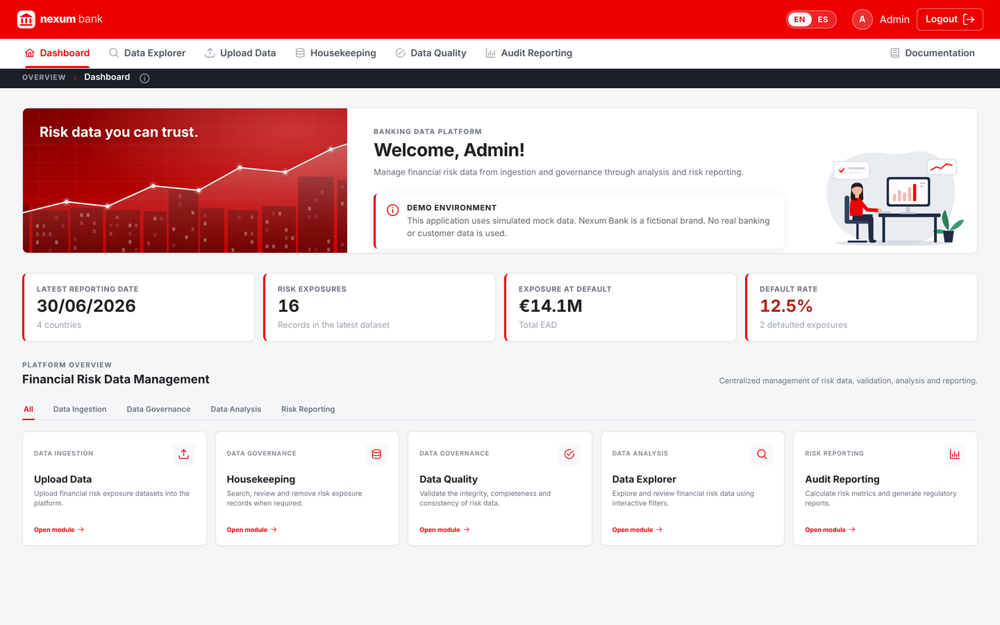
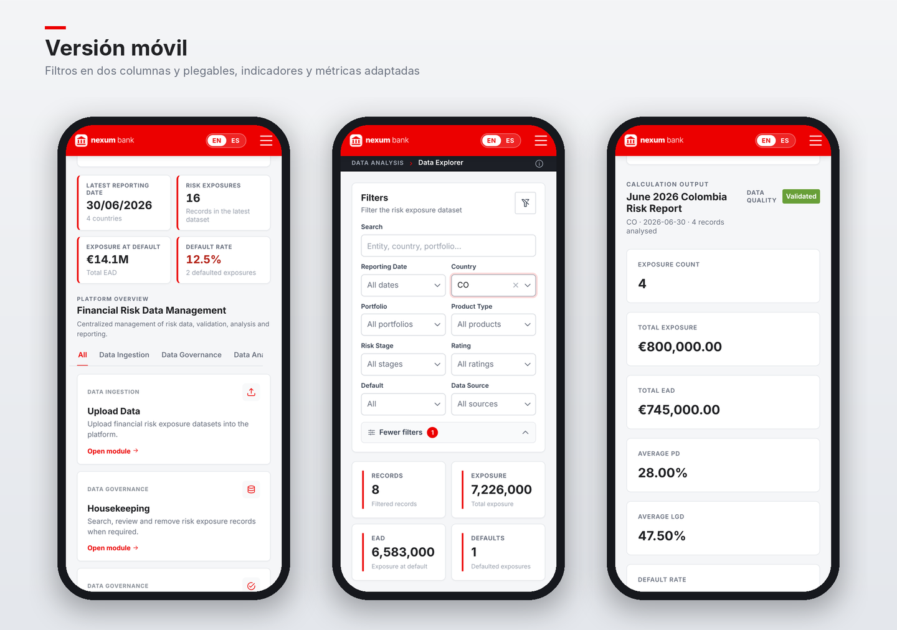

# Banking Data Platform

Plataforma web Full Stack para la gestión de datos de riesgo bancario: carga de datos (CSV), controles de calidad, housekeeping, exploración y reporting de métricas de riesgo. Datos 100 % simulados.

**Angular 18 · TypeScript · PrimeNG · Python · Django REST Framework · Docker** — sin base de datos: el backend guarda los datos en archivos JSON.

Interfaz responsive (escritorio y móvil) con la marca ficticia **Nexum Bank** (del latín *nexum*, el contrato de préstamo de la antigua Roma): no representa a ninguna entidad financiera real.

Demo (datos simulados): https://banking-data-platform.onrender.com





Arquitectura y funcionalidades en detalle: [docs/Arquitectura_Flujo_Info_Funcionalidades.md](docs/Arquitectura_Flujo_Info_Funcionalidades.md). Más capturas en el [README del frontend](frontend/README.md#screenshots).

## Estructura del repositorio

```
banking-data-platform/
├── frontend/           Angular 18 + PrimeNG (nginx en Docker)        → frontend/README.md
│   └── src/assets/demo-data/  CSV de ejemplo (válidos e inválidos), descargables desde Upload Data
├── backend/            Django REST Framework + gunicorn, datos en JSON → backend/README.md
│   └── data/seed/      Estado inicial de la demo (PE 09/2022 y ES 03/2026 cargados)
├── docs/               Arquitectura, flujo de información y funcionalidades
└── docker-compose.yml  backend + frontend
```

`frontend/` y `backend/` conservan el historial completo de sus repositorios originales.

## Cómo funcionan los datos

No hay base de datos: cada tabla es un archivo JSON en el backend (`backend/data`).

- **Crece** al subir CSV desde Upload Data y **se reduce** al borrar desde Housekeeping. Data Explorer, el Dashboard, Data Quality y Audit Reporting leen siempre ese mismo JSON.
- Arranca con el estado inicial de `backend/data/seed`, que tiene **PE 09/2022** y **ES 03/2026** ya cargados. El resto de CSV de demostración se suben durante la demo: en **Upload Data** aparecen como tarjetas para usarlos directamente o descargarlos. Están en `frontend/src/assets/demo-data` (así la web los sirve también en Render); su contenido y los errores esperados se describen en [Tablas_errores_o_no_descripcion.txt](frontend/src/assets/demo-data/Tablas_errores_o_no_descripcion.txt).
- En Render (plan gratuito) el disco no es persistente: cada reinicio o despliegue devuelve la demo al estado inicial. En local se conserva; para restablecerla: `python manage.py reset_demo_data`.

## Arrancar con Docker (recomendado)

```bash
docker compose up --build
```

Abre http://localhost:8080. Se levantan dos contenedores:

| Servicio | Qué hace |
|---|---|
| `backend` | Django + DRF servido con gunicorn; datos en JSON |
| `frontend` | Angular compilado y servido con nginx, que redirige `/api` al backend |

## Desarrollo local (sin Docker)

```bash
cd backend
pip install -r requirements.txt
python manage.py runserver 8001

cd frontend
npm install --legacy-peer-deps
npx ng serve --port 4201
```

## Tests

```bash
cd backend && python manage.py test               # subida, calidad, informes, borrado, log de auditoría y JWT
cd frontend && npx ng test --watch=false          # 10 tests de componentes y servicios
```

## Autenticación y seguridad

- **Dos formas de entrar**: acceso demo (`admin` / `1234`) e **Iniciar sesión con Microsoft** (Microsoft Entra ID, OAuth 2.0 + PKCE). Si Entra ID no está configurado, el botón de Microsoft no aparece y la app funciona igual.
- **JWT**: el login demo (`POST /api/auth/login/`) emite un token HS256; el login con Microsoft usa el token RS256 de Entra ID, que el backend verifica con las claves públicas de Microsoft (firma, audiencia, emisor y caducidad). El resto de endpoints exige `Authorization: Bearer <token>` y responde **401** si falta o no es válido.
- **Roles (RBAC)**: `DataAdmin` puede subir y borrar datos; `Analyst` solo consulta (**403** al intentar escribir). Cualquier cuenta de Microsoft entra como `Analyst`; `DataAdmin` solo se concede a usuarios del tenant propio con ese rol asignado, ignorando roles que otro tenant pueda asignar.
- En Angular, un **interceptor HTTP** añade el token solo a las peticiones a la API y cierra la sesión ante un 401; un **guard** protege todas las rutas privadas. El token se guarda en `sessionStorage` (se borra al cerrar la pestaña).
- **Fuerza bruta**: el login está limitado a 10 intentos por minuto (HTTP 429) y compara credenciales en tiempo constante.
- **CORS** con lista blanca explícita y sin credenciales; cabeceras `X-Frame-Options`, `nosniff`, `Referrer-Policy` y HSTS configurable.

Guía para activar el login con Microsoft: [docs/Entra_ID_Setup.md](docs/Entra_ID_Setup.md).

## Configuración del backend

Variables de entorno (sin secretos en el código):

| Variable | Por defecto (desarrollo) |
|---|---|
| `DJANGO_SECRET_KEY` | clave de desarrollo (cámbiala en producción) |
| `DJANGO_DEBUG` | `false` (en local, `true` para ver errores detallados) |
| `DJANGO_ALLOWED_HOSTS` | `*` |
| `CORS_ALLOWED_ORIGINS` | `http://localhost:4200,http://localhost:4201` (solo desarrollo: en producción web y API comparten dominio) |
| `JWT_SECRET` | la `DJANGO_SECRET_KEY` |
| `JWT_ACCESS_TOKEN_MINUTES` | `60` |
| `DEMO_USERNAME` / `DEMO_PASSWORD` | `admin` / `1234` |
| `LOGIN_RATE_LIMIT` | `10/min` |
| `DEMO_ROLE` | `DataAdmin` (o `Analyst` para un demo de solo lectura) |
| `ENTRA_TENANT_ID` / `ENTRA_CLIENT_ID` | vacías: login con Microsoft desactivado |
| `ENTRA_ALLOWED_TENANTS` | vacía: cualquier cuenta de Microsoft (como `Analyst`) |
| `DJANGO_HSTS_SECONDS` | `0` (en producción con HTTPS, p. ej. `31536000`) |
| `DATA_DIR` | `backend/data/runtime` (para un disco persistente, apúntala a él) |

## Despliegue en Render

**Backend — Web Service** (Python 3)

| Campo | Valor |
|---|---|
| Root Directory | `backend` |
| Build Command | `pip install -r requirements.txt` |
| Start Command | `gunicorn backend.wsgi:application --bind 0.0.0.0:$PORT --workers 2 --timeout 120` |
| Variables | `PYTHON_VERSION=3.12.7`, `DJANGO_SECRET_KEY`, `DJANGO_DEBUG=false`, `DJANGO_ALLOWED_HOSTS=<tu-backend>.onrender.com` |

**Frontend — Static Site**

| Campo | Valor |
|---|---|
| Root Directory | `frontend` |
| Build Command | `npm ci --legacy-peer-deps && npx ng build --configuration production` |
| Publish Directory | `dist/frontend/browser` |
| Variables | `NODE_VERSION=22` |

Redirects/Rewrites del frontend, **en este orden**:

| Source | Destination | Action |
|---|---|---|
| `/api/*` | `https://<tu-backend>.onrender.com/api/*` | Rewrite |
| `/*` | `/index.html` | Rewrite |

La primera regla hace que la web y la API compartan dominio (no hace falta CORS); la segunda permite recargar rutas como `/dashboard`. Con el Root Directory, cada servicio solo se redespliega cuando cambia su carpeta.

## Licencia

© 2026 Alvaro Ruiz Ramírez. Todos los derechos reservados. Puedes ver el código y ejecutarlo en local solo para evaluar mi trabajo (por ejemplo, en un proceso de selección); cualquier otro uso requiere permiso previo por escrito. Detalles en [LICENSE](LICENSE).
