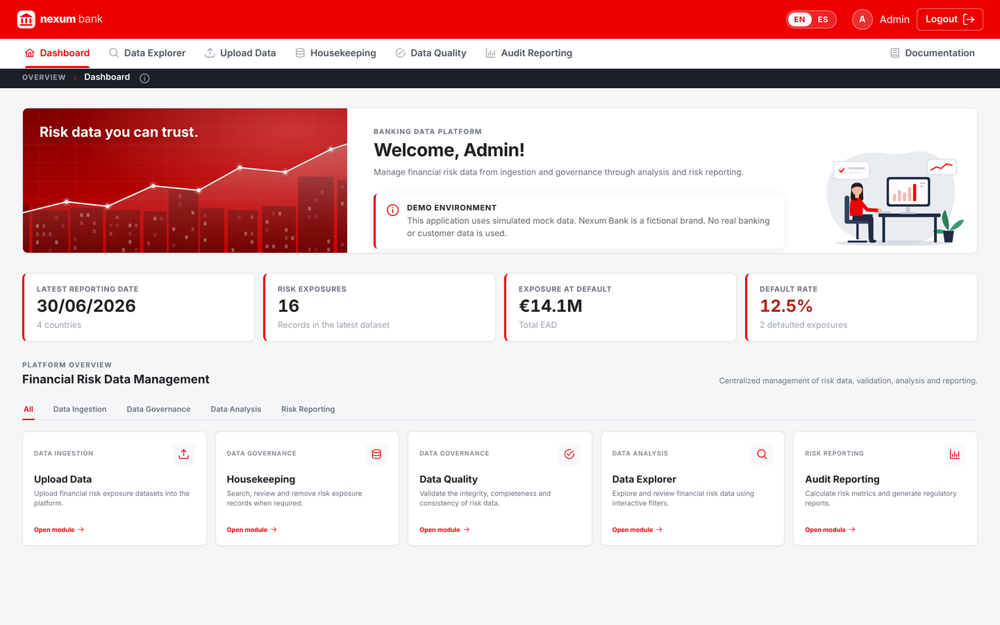
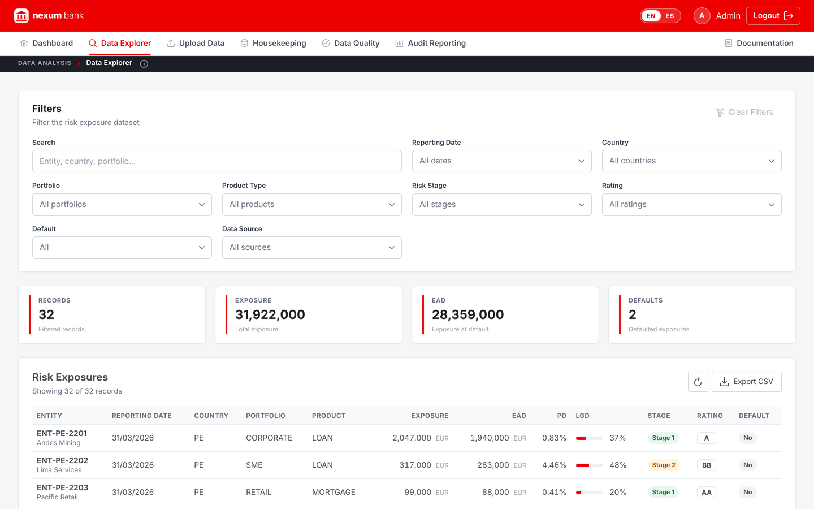
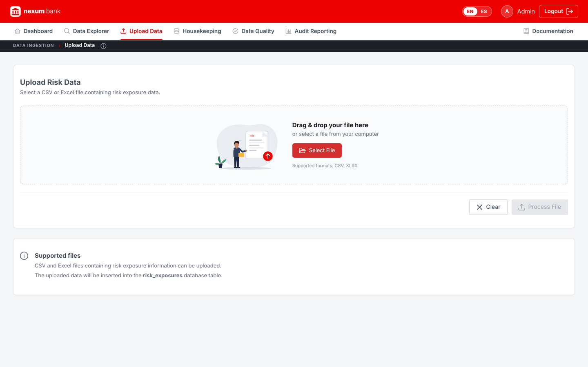
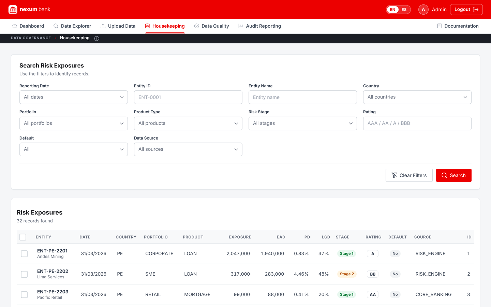
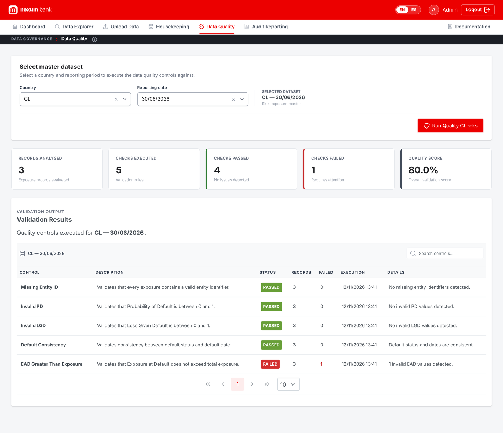
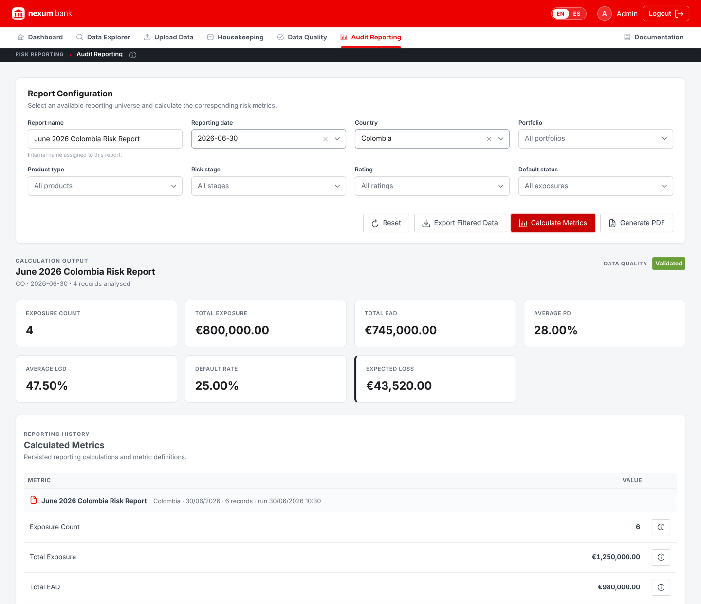
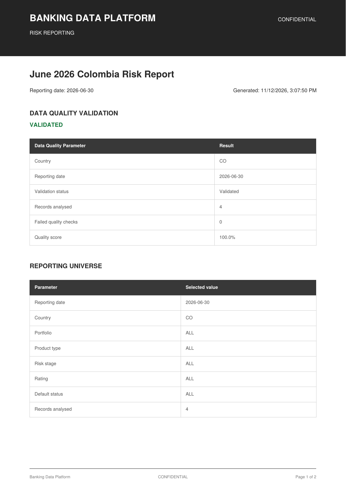
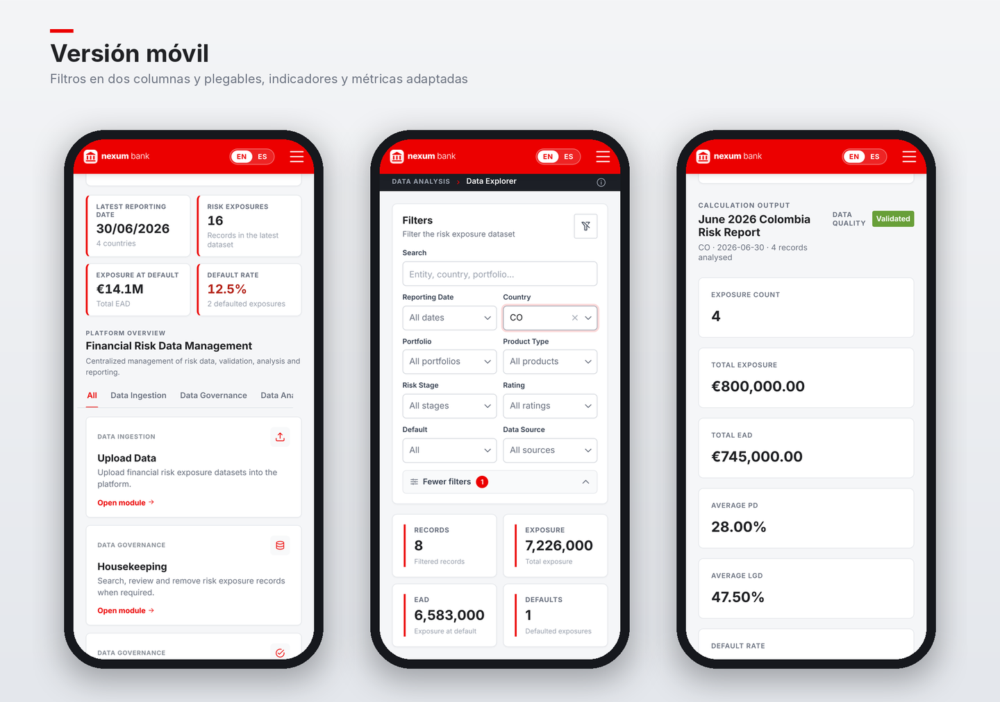

# Banking Data Platform — Frontend

Frontend web application for a banking data governance and regulatory reporting platform, branded for **Nexum Bank**, a fictional bank used as the demo brand.

The application provides an interactive interface for managing banking risk exposure data, performing data quality checks, exploring datasets and reviewing regulatory reporting results.

## Features

- Interactive dashboard
- CSV data upload interface
- Dataset management
- Data Quality controls
- Data validation and monitoring
- Data Explorer with interactive filters
- Risk reporting and analysis
- Audit reporting
- Housekeeping and data management
- Audit log visualization
- Responsive, mobile-first user interface (collapsible navigation drawer, adaptive grids and tables)
- Optional in-browser mock data (`useMockData`) to run without the backend

## Technologies

- Angular
- TypeScript
- HTML
- CSS (responsive layouts with CSS Grid / Flexbox)
- PrimeNG
- RxJS
- REST API
- Render

## Architecture

The frontend is built with Angular using a component-based architecture.

The application communicates with the Django REST API to retrieve, process and display banking risk data.

The frontend is responsible for:

- User interface and navigation
- Data visualization
- Form handling
- Client-side validation
- Filtering and data exploration
- Reporting views
- API communication
- Application state management

## Backend

This frontend works together with the Banking Data Platform backend, in [`../backend`](../backend) of this repository.

## Demo

The application is deployed on Render:

https://banking-data-platform.onrender.com

## Production Demo

The deployed version reads and writes through the backend API (`/api/`, rewritten by Render to the backend service). Uploads, deletions, quality checks and reports are shared by every visitor and reset to the initial demo data whenever the backend restarts.

All data is simulated: no real banking or customer data is used.

The application is designed to demonstrate the functionality and architecture of a banking data governance and regulatory reporting platform.

## Design

- Fictional brand **Nexum Bank** (`src/assets/logo`, `src/assets/icon`): SVG logo, favicon and touch icon.
- One red brand palette applied to every PrimeNG component (buttons, dropdowns, paginator, checkboxes).
- Responsive layout: tab navigation on desktop and a slide-down drawer on mobile (≤ 900 px).
- Lightweight SVG hero illustration instead of a heavy bitmap.
- Shared filter pattern across screens (same controls, two-column layout and collapsible secondary filters on mobile).
- Thin location bar ("Module › Screen") with an (i) button describing each screen.

> Nexum Bank is a fictional brand created for this portfolio project. It is not related to any real financial institution.

## Screenshots

### Dashboard
Key indicators for the latest reporting date and access to every module.

### Data Explorer

### Upload Data

### Housekeeping

### Data Quality
The demo dataset includes one intentional issue (EAD greater than exposure) so the controls have something to detect.

### Audit Reporting

### PDF Report

### Mobile
Filters in two columns with secondary filters collapsed, adapted KPIs and metrics.

## License

© 2026 Alvaro Ruiz Ramírez. All rights reserved. You may view the code and run it locally only to evaluate my work (for example, in a hiring process); any other use requires prior written permission. See [LICENSE](../LICENSE).
